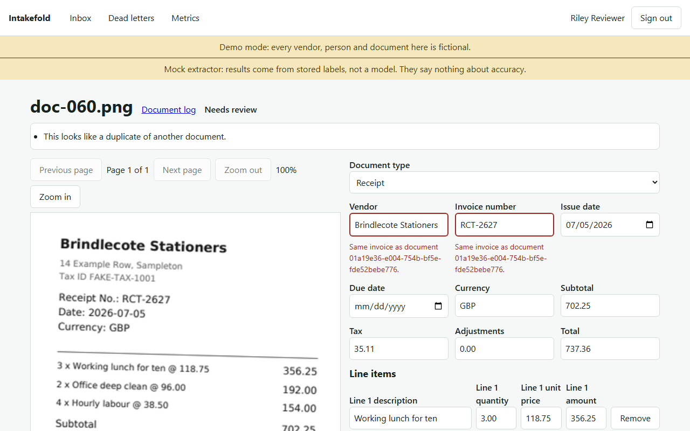
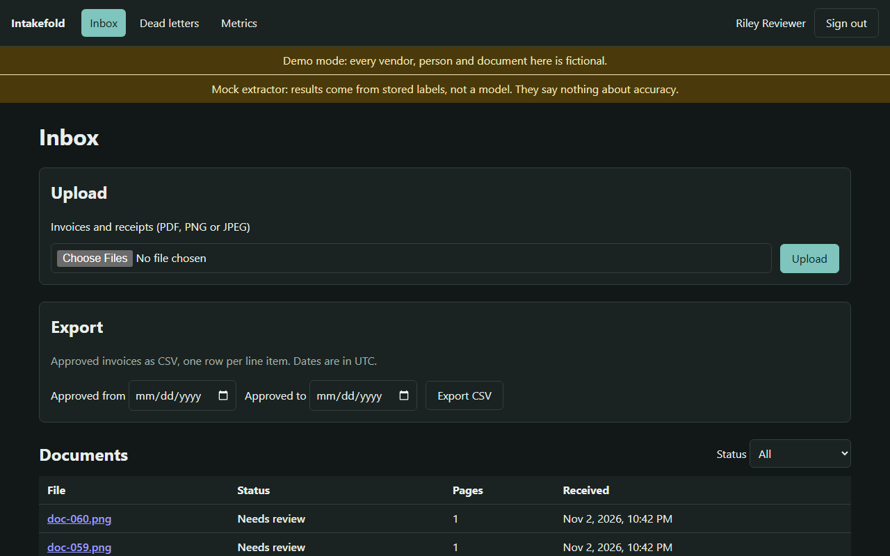
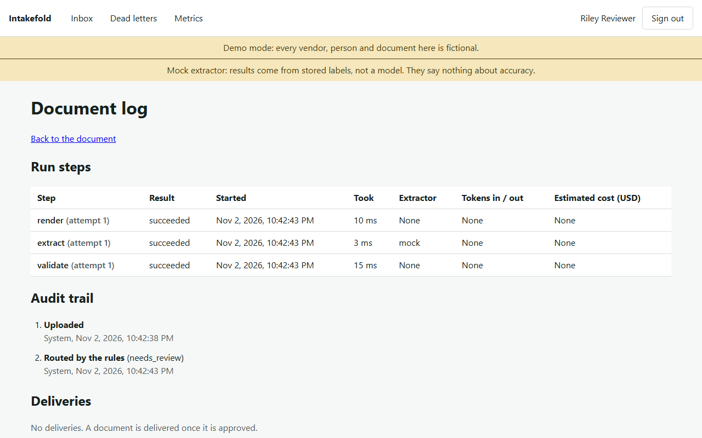
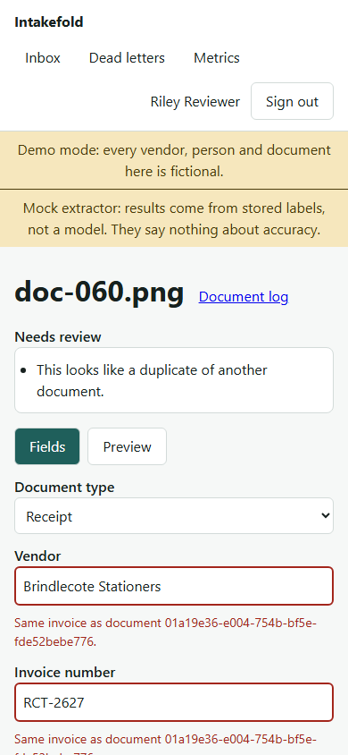
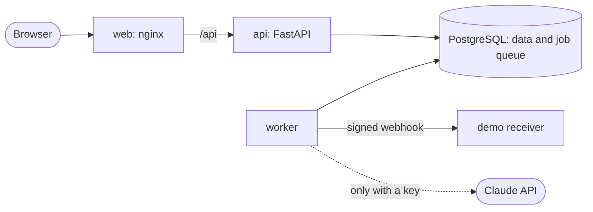

# Intakefold

**Intake automation for invoices and receipts.** An LLM reads each document, rules written in code check what it found, and anything doubtful goes to a person, who corrects it beside the page before it is sent downstream.

An independent portfolio project, built with AI assistance. Every vendor, person and document in it is fictional.



## What it does

1. Someone uploads invoices and receipts: PDF, PNG or JPEG, up to 25 at a time.
2. A background worker renders the pages and extracts vendor, invoice number, dates, currency, line items and totals into a strict schema.
3. Rules check that the lines add up, the totals reconcile, the dates are plausible, the vendor is known and the invoice is not a duplicate.
4. A clean result is approved automatically. Anything else goes to a review queue with its reasons.
5. A reviewer corrects the fields beside the page, then approves or rejects, with the keyboard if they like.
6. Approved invoices go to a downstream system by signed webhook, and export as CSV.
7. Every step is logged with timing, and every correction with who made it.

## Try it

You need [Docker](https://docs.docker.com/get-docker/) with Compose v2. No API key: the demo uses a mock extractor that returns stored labels.

```bash
git clone https://github.com/bojanpetkovski18/intake-fold.git
cd intake-fold
docker compose up --build
```

When the logs settle, open <http://127.0.0.1:8180>. The sign-in page lists two demo accounts with their passwords: a reviewer and an admin. The webhook receiver's page is at <http://127.0.0.1:8190>.

To stop, press Ctrl+C, then `docker compose down`. Add `-v` to delete the demo data as well.

All ports are bound to 127.0.0.1. If 8180, 8190 or 5441 is taken, copy `.env.example` to `.env` and change `WEB_HOST_PORT`, `SINK_HOST_PORT` or `POSTGRES_HOST_PORT`; when you change the web port, change `WEB_ORIGINS` to match.

**Or in the browser:** [](https://codespaces.new/bojanpetkovski18/intake-fold) starts the same stack in a codespace and forwards port 8180. The first start builds the images and takes a few minutes.

## A guided tour

1. **Sign in** as the reviewer. The banners say this is a demo, and that the mock extractor's results say nothing about accuracy.
2. **Inbox:** 20 fictional documents were uploaded at start. Filter by "Needs review" and open one.
3. **Review:** the reasons sit at the top, and the flagged fields are outlined. Fix a field, save, and the rules run again. Approve or reject; a document that still fails a rule, or contains text aimed at the extractor, needs a written reason to approve.
4. **Document log:** the run steps with timings, the audit trail of every correction, and the webhook delivery with each attempt.
5. **Export** the approved invoices as CSV from the inbox. Cells that a spreadsheet would run as formulas are neutralized.
6. **Metrics:** processed, auto-approved, sent to review, failed and average time, labelled by extractor.
7. **Sign in as the admin** to requeue dead jobs or reset the demo data.

| Inbox, dark theme | Document log | On a phone |
|---|---|---|
|  |  |  |

## How it works



- The API never calls the model. The worker claims jobs from PostgreSQL with `FOR UPDATE SKIP LOCKED`, under a lease that a heartbeat renews, and does the work outside any transaction.
- The model only proposes data. It is validated against a schema, and routing is decided by deterministic rules in code, never in the prompt.
- Document text is untrusted. Instructions found in it are flagged for a person, never followed.

More in [docs/ARCHITECTURE.md](docs/ARCHITECTURE.md): request flow, authentication, concurrency, delivery and the data model.

## Stack

| Part | Choice | Why |
|---|---|---|
| API and worker | Python 3.15, FastAPI, SQLAlchemy 2.1, Pydantic 2 | Typed validation at every boundary; one codebase, two processes |
| Database and queue | PostgreSQL 18 | `SKIP LOCKED` makes a reliable queue without a second datastore |
| Migrations | Alembic | Reviewed revisions, checked against the models in CI |
| Extraction | Anthropic SDK, behind an `Extractor` interface | A mock behind the same interface runs the demo and the tests for free |
| Documents | pypdf, Pillow, PDFium | Full decode on upload; rendering only in the worker |
| Front end | React 19, TypeScript, Vite, TanStack Query | Typed client, cached queries, small static build |
| Tests | pytest with Testcontainers, Vitest with axe-core, Playwright | Real PostgreSQL in tests, accessibility checks in unit tests and the browser |
| Packaging | Docker Compose, unprivileged nginx | One command, non-root containers, strict response headers |

Versions are pinned and were at least two weeks old when chosen; see [docs/RESEARCH.md](docs/RESEARCH.md).

## Quality

What is checked on every push, in CI, with the mock extractor:

- **Backend:** ruff, pyright in strict mode, pip-audit, and 685 pytest tests, 315 of them against a real PostgreSQL in a container. They include two workers racing for jobs, a worker killed mid-job, a model that tries to get an injected document approved, and anonymous, wrong-role and missing-CSRF requests across the whole route table.
- **Front end:** ESLint, Prettier, TypeScript and 128 Vitest tests, including axe checks on 24 screen states.
- **End to end:** one Playwright journey against the built Compose stack, three runs in a row with no retries. It signs in, uploads, corrects, approves, checks the webhook arrived, exports, reads the metrics and requeues a dead job. It fails on any console error, CSP violation or axe finding.
- **Repository:** gitleaks over the full history, actionlint and editorconfig.

An accessibility audit in a real browser found no axe violations in 116 runs across nine widths and both themes ([docs/AUDIT.md](docs/AUDIT.md)).

**Extraction accuracy has not been measured.** The evaluation harness is built and tested ([`eval/`](backend/src/intakefold/eval/), D-074), but it has only run with the mock extractor, which tests the plumbing and says nothing about accuracy. A run with a real model is planned and needs the owner's API key.

Every number in this README has a dated row, with its method, in [PROGRESS.md](PROGRESS.md) under "Measured results".

## Develop

Python with [uv](https://docs.astral.sh/uv/), Node 24, Docker and, on Windows, Git Bash.

```bash
cp .env.example .env               # placeholders; change the passwords, and set
                                   # ALLOW_INSECURE_COOKIES=true for the Vite server
docker compose up -d --wait db
cd backend
uv sync --locked
uv run --env-file ../.env alembic upgrade head
uv run --env-file ../.env python -m intakefold.db.seed
uv run --env-file ../.env uvicorn --factory intakefold.api.app:create_app --port 8100 --no-proxy-headers
uv run --env-file ../.env python -m intakefold.worker      # in a second terminal
cd ../frontend && npm ci && npm run dev                     # in a third
```

`bash scripts/check.sh` runs everything CI runs, and `bash scripts/e2e.sh` runs the Playwright journey against the built stack. The full command list is in [CLAUDE.md](CLAUDE.md).

## Decisions and lessons

Numbered decisions with their reasons and trade-offs are in [DECISIONS.md](DECISIONS.md). A few that shaped the project:

- **Rules in code, not in the prompt** (D-065): a model can be talked into things, a rule cannot. A document flagged for embedded instructions always needs a person.
- **PostgreSQL as the queue:** one datastore to run, and transactional enqueue with the data it belongs to.
- **Only our code reads forwarded headers** (D-042): with default flags, uvicorn trusted `X-Forwarded-For` from local peers, and a forged value dodged the sign-in limit every time.
- **Check in a real browser:** a focus bug passed every unit test and showed up only in Chromium. The end-to-end journey then found two more: nginx kept proxying to a replaced API container's old address, and requeuing a dead webhook delivery never sent it again. Both have regression tests. A full-codebase review then fixed ten more, the worst an empty invoice that could be approved without a reason ([docs/REVIEW.md](docs/REVIEW.md)).

## Limits

- No hosted demo: it runs locally or in a codespace.
- No Arabic or handwriting, email intake, multiple tenants or vector search.
- The sink, the demo's downstream system, forgets which events it has seen when it restarts.
- Screen readers, Firefox and Safari have not been tested.

## Built with AI assistance

Written with Claude Code under the owner's direction, one milestone at a time. The owner reviewed and merged every change; the milestone briefs are in [prompts/](prompts/).

## Licence

[MIT](LICENSE).
