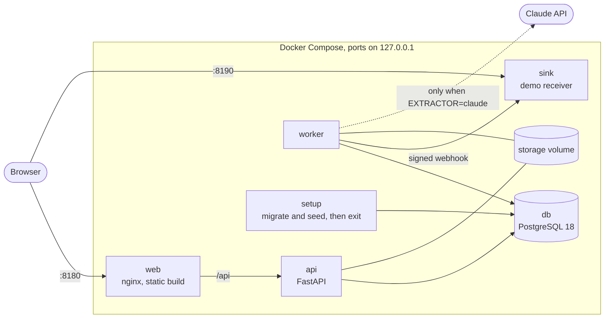
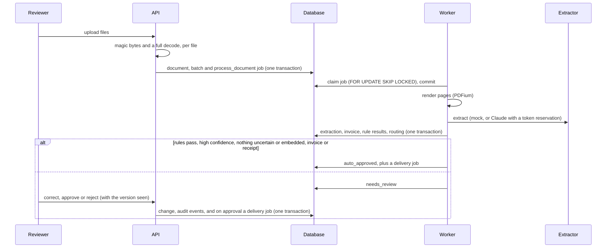
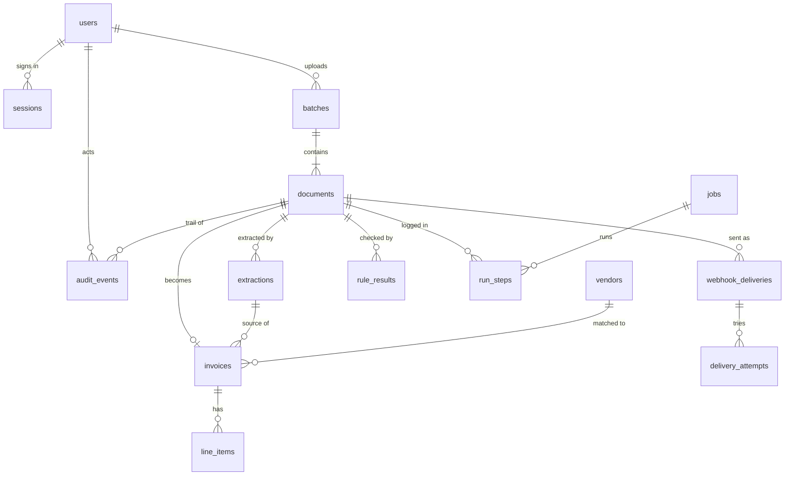

# Intakefold architecture

Written from the code as of M14 (2026-11-02). File references are to `backend/src/intakefold/` unless they start with another top-level folder.

## Containers

- **Two images** (D-020): `backend/Dockerfile` runs as `api`, `worker`, `sink` and `setup` by command; `frontend/Dockerfile` is unprivileged nginx with the production build. Both run as non-root users (uid 10001 and 101).
- **Start order:** `db` healthy, then `setup` runs `alembic upgrade head` and the seed, then `api` and `worker` start, then `web` once the API is healthy. In demo mode the seed queues the 20-document demo batch once (D-076).
- **Health checks:** `api` on `/api/health`, which checks the database; `sink` on `/events`; `web` on `/`; `db` with `pg_isready`. The worker has none: it serves nothing to probe, and a crash ends the container, which `restart: unless-stopped` brings back.
- **Proxy trust:** nginx has a fixed address on the Compose network, and `TRUSTED_PROXIES` names only that address, so only nginx may state the client IP for rate limits (D-042). nginx resolves the API through Docker's DNS on each request, so a replaced API container is found again.

## Request flow

1. The browser loads the static app from nginx. nginx adds the CSP and the other security headers (D-078) and proxies `/api/` to the API.
2. `RequestContextMiddleware` (`api/middleware.py`) gives each request a trace ID, logs one structured line when it ends, and turns unhandled errors into RFC 9457 problem details with that ID.
3. `enforce_access` (`api/access.py`) runs on every route. A route is public only if it is in `PUBLIC_ROUTES`: health, sign-in and the demo accounts. Every other route needs a session, and an unsafe method also needs an allowed `Origin` and the CSRF token. Roles are checked on the server by the route's dependency (`Reviewer`, `Admin`).
4. The route binds the input and calls a handler in a domain package (`documents/`, `jobs/`, `delivery/`, `audit/`, `demo.py`). Filtering, sorting, paging and aggregation happen in SQL.

## Authentication

- **Passwords:** Argon2 with the library defaults (`identity/passwords.py`). Unknown emails are checked against a decoy hash, so timing does not reveal which accounts exist.
- **Sessions:** a random token in an HttpOnly, `SameSite=Strict` cookie scoped to `/api`, Secure unless `ALLOW_INSECURE_COOKIES` is set for local http. The database stores only its SHA-256 hash. Sessions last 12 hours (D-041).
- **CSRF:** the token is an HMAC of the session token. The client gets it from `/api/auth/me` and keeps it in memory only; the server stores its hash and compares in constant time.
- **Rate limits:** sign-in and upload, per client IP (`api/rate_limit.py`).

## Processing

- **Uploads** (`documents/`): the content type comes from magic bytes plus a full decode with pypdf or Pillow, never from the file name. Identical files are stored once, by SHA-256.
- **Extraction** (`extraction/`): `Extractor` is the seam. The mock returns stored labels and makes no network call. The Claude extractor reserves tokens against the batch cap in one SQL statement before the call and settles to actual use after it. Model output crosses into the domain only after Pydantic validation, with a bounded number of repairs.
- **Rules and routing** (`validation/`): pure functions over domain objects. `validation/apply.py` is the only part that touches the database. Document text is data: instructions found in it are flagged, never followed, and a flag always sends the document to a person (D-065).
- **Review:** each reviewer action names the document version it saw, so two reviewers cannot overwrite each other (409). Every correction is an audit event naming who changed what. `audit_events` rows cannot be updated or deleted.

## Concurrency and the job queue

- PostgreSQL is the queue (`jobs/queue.py`). A worker claims the next queued job with `FOR UPDATE SKIP LOCKED`, sets a 5-minute lease and commits, then does the work outside any transaction.
- A heartbeat thread renews the lease every third of its length. Every 30 seconds a worker returns jobs with expired leases to the queue, so a killed worker's job is picked up again.
- Handlers are idempotent, so at-least-once delivery is safe. A failure is retried with backoff (5 seconds doubling to at most 5 minutes, half of it random), up to 5 attempts, and then the job is dead. A permanent error goes straight to dead.
- Dead jobs are listed for admins, who can requeue one. A requeue reopens its document or delivery in the same transaction.
- Run more `worker` containers for more throughput. Each claims one job at a time.

## External integrations

- **Claude API:** only from the worker, only when `EXTRACTOR=claude`, with the key from the environment. The demo, the tests and CI use the mock, and demo mode refuses any other extractor.
- **Webhooks** (`delivery/`): targets come only from `WEBHOOK_TARGETS` in configuration. Each delivery is signed with HMAC-SHA256 over the timestamp and the body (`Intakefold-Signature: t=…,v1=…`) and carries an event ID. The sender holds no database connection during the call and does not follow redirects.
- **Sink** (`backend/src/intakefold_sink/`): the demo receiver. It verifies the signature within 5 minutes, ignores a repeated event ID, and lists what it received on port 8190. It has no database.

## Delivery and export

- An approval writes its delivery rows and jobs in the same transaction, so an approved document is never left without one.
- Every attempt is recorded with status code, error code and duration, and shows on the document log.
- CSV export (`delivery/export.py`) streams approved invoices, one row per line item, filtered by approval date. Text cells that start with a formula character get a leading `'`; money is written from `Decimal` and stays numeric (D-070).

## Data model

`jobs` refer to their document or delivery through a JSON payload, not a foreign key, so the queue stays unaware of documents. Money columns are `NUMERIC`; timestamps are UTC.

## Observability

- Structured JSON logs with trace IDs. Logs never contain secrets, cookies, tokens, full request bodies or document contents; errors log their type, not their message.
- `run_steps` are written as work happens, so a crash still leaves a trace. The document log and the metrics are read from them and from document status, in SQL (D-072).

## Demo mode

`DEMO_MODE=true` needs the mock extractor and both demo passwords. The sign-in page shows the fictional accounts, a banner says it is a demo, and an admin can reset: the document tables are truncated under a table lock, their files deleted after the commit, and the demo set queued again (D-076, D-077).
